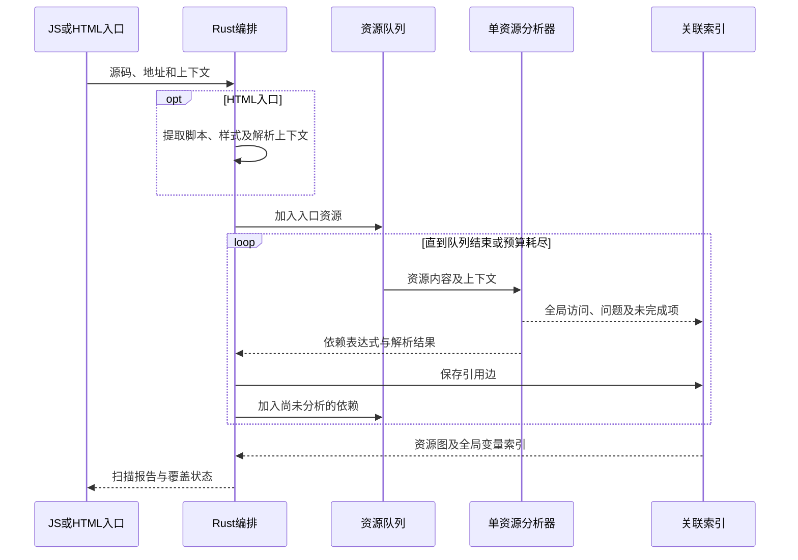
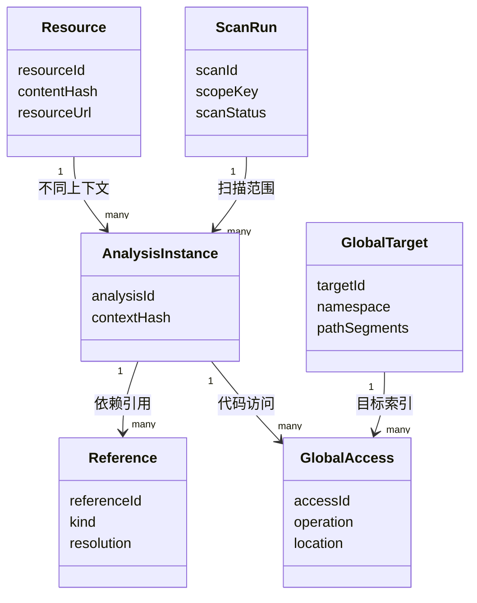

# 目标与范围

本方案面向扫描工具开发与技术评审，定义以 JS 或 HTML 为入口的静态扫描能力。工具递归分析可解析依赖，建立全局变量与声明、读写位置、资源版本及入口引用链的关联索引，并输出 global、DOM、CSS 候选问题。

| 能力 | 设计范围 |
| --- | --- |
| 双入口 | 支持本地文件、HTTP(S) URL 和代码内容。JS 支持单资源或递归扫描，HTML 提取入口后复用同一资源扫描流程。 |
| 全局变量索引 | 记录全局对象属性、全局词法绑定、内置对象属性及原型访问，区分声明、读取、写入、删除和属性定义。 |
| 递归依赖 | 解析 ESM、CSS 引用及受支持的 webpack／Vite 加载模式。无法确定的依赖保存位置和原因。 |
| 证据边界 | 输出静态关系和候选问题。代码实际执行、退出残留、内存增长与最终发布决策由运行采集和平台处理。 |

本文描述目标实现，接口名和内部结构为本工具的设计定义。Oxc 等依赖提供基础能力，不直接提供完整的全局污染扫描产品。

# 技术架构

| 层次 | 选型 | 职责与取舍 |
| --- | --- | --- |
| JS 分析核心 | Rust + oxc_parser / oxc_ast / oxc_semantic | 一次解析后复用 AST、作用域和符号引用。别名传播、有限求值与污染规则在 Rust 内实现。 |
| Node 接口 | napi-rs | 提供 npm 薄封装，传入扫描请求与上下文，仅返回结构化结果，不传输完整 AST。 |
| 任务编排 | Rust | 输入适配、资源获取、队列、取消、预算、缓存及报告汇总。 |
| HTML 分析 | Rust + html5gum | 按 HTML5 分词提取脚本、样式、base 和 Import Map，保留源位置；特殊树构造上下文记录覆盖缺口。 |
| CSS 分析 | Rust + cssparser | 按 CSS Syntax 解析选择器、声明、动画名和资源引用，保留解析恢复区域。 |
| 依赖解析 | URL API + Import Map 解析层 + 打包器适配器 | 遵循浏览器路径语义。oxc-resolver 仅用于显式启用的本地 Node 包解析。 |
| 源码定位 | sourcemap | 产物位置为基础证据，source map 补充源码位置，不覆盖原始位置。 |
| 结果与索引 | JSON Schema + jsonschema + 内存倒排索引 | 输出标准报告及可分批写入的 JSONL。平台通过适配层持久化和查询。 |

采用 Oxc 是为了直接复用 Rust 侧的作用域和符号分析。Babel 适合仅维护 JS／TS 的团队，SWC 适合已有相关插件基础的场景，两者都仍需实现本方案的分析层。原生扩展带来平台二进制构建成本，交付包覆盖实际 CI 和开发环境，Oxc 各组件锁定同批兼容版本。性能指标以真实产物测量为准。

# 输入与双入口流程

## 输入模型

| 字段 | 含义与处理 |
| --- | --- |
| entry.kind | js 或 html。由调用者显式指定，避免依赖 URL 后缀猜测内容。 |
| entry.source | file、url、content 三选一。content 输入同时提供资源标识。 |
| resourceUrl / baseUrl | 资源的逻辑地址及相对地址解析基准。本地镜像可映射到线上逻辑 URL。 |
| scriptMode | classic、module 或 unknown。HTML 从脚本属性获得，JS 入口由调用者提供或由已知格式确定。 |
| executionEnvironment | window、worker 或 unknown，决定宿主全局对象语义。 |
| importMap | 模块解析上下文。HTML 按文档处理顺序建立快照，保留 imports、scopes 和快照标识。 |
| dependencyMode | single 仅扫描输入资源，recursive 扫描可解析依赖。single 不承诺依赖闭包完整。 |
| scope / versions | 页面组合、发布环境、产物版本、规则版本及适配器版本，用于结果关联与复用。 |
| budgets | 并发、超时、资源数量、总字节、递归深度、求值步数和候选集合上限，由版本化配置提供。 |

scriptMode 或宿主环境缺失时，继续执行不依赖该上下文的规则，对受影响结论标记 unresolved。普通脚本不因包含动态 import 就被归类为模块。JS 入口的递归范围以已解析的加载关系为准，不扩展为全站抓取。

## 处理时序



HTML 内联 JS／CSS 使用虚拟资源标识，并保存所属 HTML、内容偏移和解析上下文。脚本按 classic、module、Import Map、数据块分别处理。内联模块相对引用使用文档基准地址，外链模块使用模块自身 URL。动态构造脚本在能够静态还原时继续分析，否则记录未完成项。

Rust 直接导出 SDK 方法和索引类，npm 加载入口与方法声明由 napi-rs 生成，报告等数据结构单独维护类型声明。扫描、依赖解析、队列、缓存、索引及报告逻辑全部在 Rust 内完成。

统一 scanResource 分析单份资源。scanJs 和 scanHtml 负责入口适配与递归编排。构建扫描与 HTML 扫描在相同内容、上下文和规则版本下复用分析结果。

# JS 语义分析与识别规则

## 分析流水线

| 阶段 | 处理 | 产出 |
| --- | --- | --- |
| 解析 | 按脚本模式建立 Oxc AST，记录语法错误及源位置。 | AST、诊断、导入导出信息 |
| 语义分析 | 建立作用域、符号绑定和引用关系，识别局部遮蔽。 | 文件内符号及引用 |
| 目标与别名分析 | 跟踪全局对象、已知对象路径及变量别名，重新赋值时更新或失效。 | 访问目标与推导依据 |
| 有限值传播 | 处理支持的纯表达式，分支合并为有限候选，未知调用和可变对象使相关值失效。 | 精确值、有限集合或 unknown |
| 事实提取 | 记录声明、读写、删除、属性定义及上下文，同时提取依赖和 DOM 操作。 | globalAccesses、dependencies、findings |
| 跨资源关联 | 按执行范围与解析上下文关联访问，保留多处定义、候选和不确定性。 | 全局目标索引及来源引用链 |

不执行被扫描代码，不使用 eval 或 VM 求值。有限求值支持字面量、可证明的字符串拼接、模板字符串、常量键查表和受限条件分支。一般函数调用、getter、Proxy、动态输入不求值。循环、递归和候选扩张受到预算约束，超过预算转为 unknown。

首版以文件内、按执行顺序的绑定与赋值传播为基础。IIFE 和打包器包装函数仅在参数绑定、调用方式及副作用能够证明时传播。跨模块输出有限常量摘要，循环依赖迭代到稳定或预算耗尽。未知函数调用不按无副作用处理。

## 全局目标分类

| 分类 | 示例 | 索引规则 |
| --- | --- | --- |
| global-object | window.foo、globalThis.foo、已证明的别名 g.foo | 在已知 Window 环境且标识符未被遮蔽时归一到同一对象属性。worker 使用独立执行范围。 |
| global-lexical | 普通脚本顶层 let / const / class | 记录全局词法绑定，不与 window 同名属性合并。 |
| global-object declaration | 普通脚本顶层 var / function | 记录全局声明候选，保留全局声明冲突或运行失败可能。 |
| builtin-property | Array.prototype.foo、document.body | 在根标识符绑定可确认时记录属性路径及操作，全局根被改写后保持候选。 |
| unbound-reference | 文件内未解析的裸标识符 foo | 跨资源关联后再判断词法绑定、对象属性或外部依赖，不直接认定为隐式全局写入。 |
| module / local | 模块顶层声明、函数参数、函数内变量 | 保留分析所需符号关系，不进入全局目标集合。 |

严格模式下未声明标识符赋值可能抛错，不能直接算全局属性创建。顶层 this、UMD 宿主选择和 globalThis 等标识符都结合脚本模式、严格模式、宿主与遮蔽关系判定。普通脚本之间的共享词法环境按页面组合关联，模块局部符号始终独立。

## 规则范围

| 对象 | 首版识别范围 | 结果边界 |
| --- | --- | --- |
| 全局 JS | 赋值、复合赋值、自增减、delete、可识别的 Object.defineProperty / defineProperties / assign、Reflect.set、原型写入与 UMD 导出。 | 复合操作同时记录读写。API 被遮蔽或改写时不按原生语义强行解释。 |
| DOM | 对已知 document、body、head 及其别名的节点插入、替换、移除、属性写入和监听器注册。 | 记录调用候选。容器外影响及退出残留需要运行数据。 |
| CSS | 全局选择器、reset、自定义属性、动画名及样式资源引用。 | 记录匹配特征，不仅凭选择器认定页面污染。作用范围和共享归属由配置补充。 |

# 依赖解析与资源图

| 依赖类型 | 解析方式 | 无法完成时 |
| --- | --- | --- |
| ESM 静态引用 | 提取 import / export from，按导入者 URL 和 Import Map 解析。 | 记录缺失映射或不支持的解析上下文。 |
| 动态 import | 常量地址直接解析，有限表达式输出候选集，并保存分支条件。 | 保留表达式位置，不能将无结果视为无依赖。 |
| webpack 产物 | 识别运行时结构、chunk 映射和 publicPath，结合已知加载上下文还原资源地址。 | 模式不支持、运行时地址未知或映射不完整时记录原因。 |
| Vite 产物 | 识别动态 import、preload 依赖数组及资源 URL 表达式。 | 保留未确定的加载边及来源位置。 |
| CSS | 递归扫描 @import。url() 记录资源关系，按资源类型决定是否参与代码扫描。 | 保留无法解析的路径和 CSS Raw 区域。 |
| 动态 DOM 加载 | 跟踪可证明的 script.src、link.href 及插入关系，静态字符串代码交回分析器。 | 运行数据才能确定的值记录 unresolved。 |
| Worker 与 iframe | 可解析入口进入独立环境及上下文，资源图保留跨环境引用。 | 无法建立子环境时明确标记覆盖缺口，不合并全局变量。 |

依赖解析器按协议分派。浏览器资源遵循 URL 和 Import Map 算法，不能自动补扩展名或尝试 Node 包目录。Import Map 保存有效快照，处理 scopes 的导入者匹配。依赖动态注册且处理时序不可确定时记录上下文缺失。

资源内容与资源实例分开：内容相同可以复用解析结果，URL、脚本模式、Import Map、宿主或 publicPath 上下文不同则分别保存分析实例。循环引用只停止重复分析，不删除引用边。async、defer 和条件加载保留为属性，不推断唯一执行顺序。

# 全局变量索引与数据结构

## 实体关系



ScanRun 组织扫描范围，Resource 保存产物身份，AnalysisInstance 区分同一产物的解析环境。GlobalAccess 保存实际代码位置，GlobalTarget 聚合已解析目标。Reference 保存资源实例之间的依赖边，供入口路径查询。图中的 many 表示可关联多条记录。

| 集合 | 核心字段 | 作用 |
| --- | --- | --- |
| resources | resourceId、requestedUrl、finalUrl、contentHash、kind、scmId | 保存资源与版本，内联资源附 HTML 来源及偏移。 |
| analysisInstances | analysisId、resourceId、contextHash、scriptMode、environment、scanStatus | 隔离解析上下文及单资源完成状态。 |
| references | referenceId、fromAnalysisId、toAnalysisIds、kind、location、resolution、condition | 保存直接依赖、候选边和加载上下文，未解析目标可为空。 |
| globalTargets | targetId、scopeKey、namespace、pathSegments、keyKind | 形成可查询的全局目标，字符串属性路径按分段数组编码。 |
| globalAccesses | accessId、analysisId、targetRefs、operation、valueType、location、evidence | 记录每次代码访问和推导依据，候选目标保留集合。 |
| findings | findingId、ruleId、kind、analysisId、accessRefs、location | 引用基础事实产生候选问题，避免重复保存独立来源。 |
| unresolved | analysisId、referenceId、location、reason、affectedCapabilities | 保存缺失上下文、动态值、解析失败和预算耗尽影响。 |

targetId 由 scopeKey、namespace 和规范化路径生成，文件内 Oxc SymbolId 不作为跨文件全局标识。无法求出的动态键不使用 null 形成统一目标，保留独立访问及表达式位置。局部 Symbol、Symbol.for 和字符串键分开建模，无法证明符号身份时不合并。

scopeKey 表示待分析的页面组合与执行环境，不直接冒充运行时 realmId。只有平台明确提供组合关系时，才汇总多个页面的潜在冲突。名称相同但 scopeKey 不同的目标仅支持跨范围检索，不自动认定互相覆盖。

## 索引与查询

| 查询 | 倒排索引 | 返回结果 |
| --- | --- | --- |
| 变量查来源 | scopeKey + namespace + path → accessIds | 所有声明、读写位置及其资源版本。 |
| 资源查全局访问 | analysisId → accessIds | 该资源在指定上下文的全局访问列表。 |
| 变量查入口 | targetId → accessIds → analysisIds → 反向引用边 | 入口集合和引用路径，分页返回以限制路径数量。 |
| 多资源冲突候选 | targetId → 写入访问集合 | 多处写入、可推断类型差异、重声明等候选。 |
| 版本差异 | 逻辑资源 + 目标 + 规则 + 上下文 + 结构化操作特征 | 新增、移除及变化。匹配不唯一时展示新增／移除，不强配。 |

accessId 用于定位本次版本中的精确证据，跨版本匹配使用独立 fingerprint，避免行号变化造成全部问题重建。内存索引以标准记录为来源，JSONL 按资源完成顺序追加，标准 JSON 报告在扫描结束后汇总。图查询采用访问集合防环，输出路径预算命中时标记查询截断，不更改扫描完成状态。

## 结果示例

以下示例展示目标归一化，两个文件中的操作都作为静态访问记录保留：

```javascript
// a.js
const g = window
g.sharedConfig = {}

// b.js
console.log(window.sharedConfig)
window.sharedConfig = createConfig()
```

| 目标 | 资源 | 操作 | 类型与依据 |
| --- | --- | --- | --- |
| global-object / sharedConfig | a.js | write | object，别名 g 解析到未遮蔽的 window。 |
| global-object / sharedConfig | b.js | read | 读取对象属性。 |
| global-object / sharedConfig | b.js | write | unknown，createConfig 返回值不可静态确定。 |

示例以已知 Window 环境、window 未被局部遮蔽且别名未重新赋值为前提。三条记录说明存在读写代码，不证明执行先后或实际覆盖。

# 结果状态与平台接入

| 状态 | 判定 | 处理 |
| --- | --- | --- |
| completed | 声明扫描范围内的必检资源和启用能力均已完成，无影响该范围的未完成项。 | 允许平台继续基于报告评估，不代表没有问题。 |
| partial | 部分资源、依赖、语义上下文或启用能力存在缺失，已有结果仍可使用。 | 保留已完成记录和缺失明细。必检缺口由平台判定 hold。 |
| failed | 入口无法读取或解析，不能建立有效扫描范围。 | 输出入口错误与诊断，不产生完整扫描结论。 |

报告另外保存 runStatus=finished／cancelled，取消或预算耗尽且已有有效结果时，scanStatus=partial。source map 是可选定位增强，缺失只降低源码定位覆盖，不使已完成的产物内容扫描失败。CSS 恢复区域和 JS 部分解析会影响相关能力覆盖。

平台适配层继续输出 build／page 报告及既有 findings、resourceResults、references、unresolved 字段。全局索引作为独立、带 indexSchemaVersion 的关联产物，通过 reportId 和 JSON Pointer 连接。现有报告字段含义保持稳定，扩展字段通过明确的格式版本接入。

静态结果提供资源、代码位置、目标与引用关系。运行记录只有在版本、资源哈希、位置及直接调用点能够对应时才建立直接来源关联。仅有全局键或时间接近的匹配保持 static_candidate，未知来源保持 unknown。扫描工具不直接执行发布阻断。

# 缓存、容错与运行约束

| 事项 | 处理规则 |
| --- | --- |
| 缓存分层 | 解析缓存按内容哈希、语言模式和 parser 版本区分。分析缓存增加宿主、Import Map、base／publicPath、规则及适配器版本。完整原始输入构成可追溯上下文。 |
| 获取与重试 | 获取层注入认证和代理配置，记录重定向后的最终 URL。超时及可重试失败按配置重试，单资源失败不终止其他分支。 |
| 并发与背压 | 下载并发、CPU 分析并发和缓冲字节分别限制。AST 生命周期限制在单次资源分析内，完成后释放。 |
| 重复与幂等 | 同一分析实例只运行一次，引用边全部保留。重跑使用稳定资源身份与版本信息去重，报告保存配置快照。 |
| 内容边界 | 不执行目标脚本。加载器限制允许访问的协议、域名或本地目录，重定向重新检查，凭据不进入报告。 |
| 取消与恢复 | 取消后停止入队并结束在途工作，保存完成项和待处理项。恢复时重新核对内容及上下文版本，不复用已变化的结果。 |

# 交付阶段与验收

| 阶段 | 交付 | 验收条件 |
| --- | --- | --- |
| 单资源与索引 | Oxc 分析核心、作用域识别、基础别名传播、全局访问索引和标准报告。 | 局部遮蔽不误归全局，词法绑定与对象属性分开，读写位置可定位。 |
| 双入口与资源图 | JS／HTML 入口、ESM／CSS 引用、Import Map、循环依赖和上下文缓存。 | 相同内容与上下文的结果一致，不同上下文不串用，入口引用链完整可查询。 |
| 动态加载与扩展规则 | webpack／Vite 适配、有限求值、DOM／CSS 规则和跨资源摘要。 | 支持模式中的依赖可还原，未知模式不猜测，未完成项包含原因和位置。 |
| 平台集成 | build／page 适配、索引产物、版本差异和运行证据关联入口。 | 每条问题可追溯资源与位置，来源候选不升级为运行事实，扫描缺口可供平台判定。 |

验收使用现有或经确认的真实产物样本与标注集，不在本方案阶段新增单元测试。统计问题精确率、召回率、依赖解析完成率、CI／HTML 同上下文一致率、未知目标占比、扫描耗时和峰值内存。召回按已标注目标及操作位置去重，未知项不计入成功解析。性能目标由首次基准形成版本化门槛，不以 parser 官方单项速度替代整链路结果。

上线先以报告模式接入，扫描器、规则、适配器与索引格式独立记录版本。升级以同一标注集对比结果差异，回退恢复上一组件组合及配置快照。历史报告保留原版本，不使用新规则覆盖历史结论。

# 技术参考

[Oxc Parser：解析能力与模块信息](https://oxc.rs/docs/guide/usage/parser)

[Oxc Semantic：作用域、符号与引用分析](https://docs.rs/oxc_semantic/latest/oxc_semantic/)

[napi-rs：Rust 与 Node 原生扩展](https://napi.rs/)

[html5gum](https://docs.rs/html5gum/0.8.4/html5gum/)

[cssparser](https://docs.rs/cssparser/0.38.0/cssparser/)

[HTML 标准：Import Map 与模块解析](https://html.spec.whatwg.org/multipage/webappapis.html#import-maps)

[Oxc Resolver：Node 模块解析](https://oxc.rs/docs/contribute/resolver)

[sourcemap](https://docs.rs/sourcemap/9.3.2/sourcemap/)

[jsonschema](https://docs.rs/jsonschema/0.59.0/jsonschema/)

[MDN：let 的脚本与模块作用域](https://developer.mozilla.org/en-US/docs/Web/JavaScript/Reference/Statements/let)
