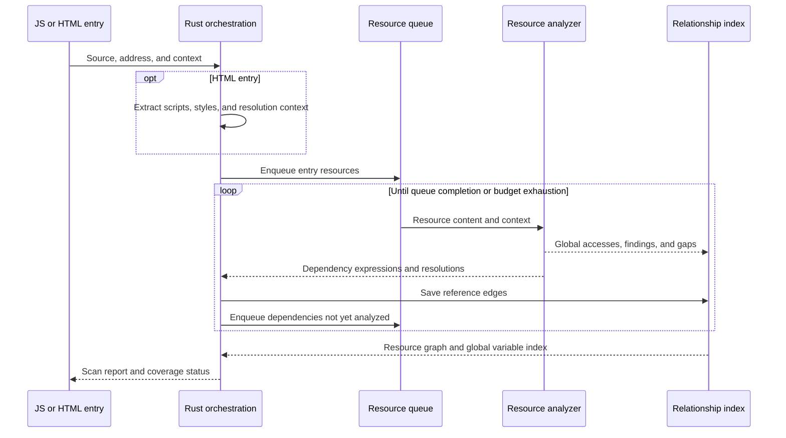
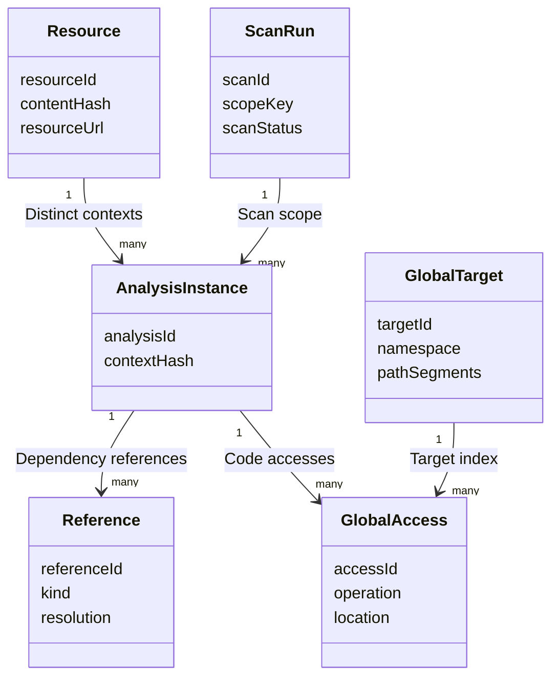

# Goals and scope

This design defines static scanning from JavaScript or HTML entry points for scanner developers and technical reviewers. The tool recursively analyzes resolvable dependencies, indexes global declarations and accesses with resource versions and entry reference paths, and reports candidate global, DOM, and CSS issues.

| Capability             | Design scope                                                                                                                                                                            |
| ---------------------- | --------------------------------------------------------------------------------------------------------------------------------------------------------------------------------------- |
| Two entry types        | Accept local files, HTTP(S) URLs, and source text. JavaScript supports single-resource or recursive scans. HTML extracts entries and reuses the resource scanning pipeline              |
| Global variable index  | Track global object properties, global lexical bindings, built-in object properties, and prototype accesses. Distinguish declarations, reads, writes, deletes, and property definitions |
| Recursive dependencies | Resolve ESM, CSS references, and supported webpack / Vite loading patterns. Preserve locations and reasons for unresolved dependencies                                                  |
| Evidence limits        | Emit static relationships and candidate findings. Runtime collection and platform integrations establish execution, teardown residue, memory growth, and release decisions              |

This document describes the target design. Interface names and internal structures belong to this tool. Dependencies such as Oxc provide underlying capabilities rather than a complete global pollution scanner. See [Supported capabilities](support.md) for implementation limits.

# Architecture

The scanner uses the following components:

| Layer                 | Technology                                            | Responsibilities and tradeoffs                                                                                                                         |
| --------------------- | ----------------------------------------------------- | ------------------------------------------------------------------------------------------------------------------------------------------------------ |
| JavaScript analysis   | Rust + oxc_parser / oxc_ast / oxc_semantic            | Parse once and reuse the AST, scopes, and symbol references. Implement alias propagation, bounded evaluation, and pollution rules in Rust              |
| Node interface        | napi-rs                                               | Provide a thin npm wrapper that accepts scan requests and context and returns structured results without transferring the full AST                     |
| Orchestration         | Rust                                                  | Adapt inputs, fetch resources, manage queues, cancellation, budgets, and caches, and assemble reports                                                  |
| HTML analysis         | Rust + html5gum                                       | Extract scripts, styles, base URLs, and import maps with HTML5 tokenization. Preserve locations and record gaps for special tree-construction contexts |
| CSS analysis          | Rust + cssparser                                      | Parse selectors, declarations, animation names, and resource references according to CSS Syntax. Preserve parser recovery regions                      |
| Dependency resolution | URL API + import map resolver + bundler adapters      | Follow browser path semantics. Reserve oxc-resolver for explicitly enabled local Node package resolution                                               |
| Source locations      | sourcemap                                             | Use artifact locations as primary evidence. Add original-source locations without replacing artifact locations                                         |
| Results and indexes   | JSON Schema + jsonschema + in-memory inverted indexes | Emit standard reports and incremental JSONL. Platform adapters provide persistence and querying                                                        |

Oxc provides scope and symbol analysis directly in Rust. Babel fits teams maintaining only JS/TS, while SWC fits existing SWC plugin infrastructure. Either alternative still requires the analysis layer described here. Native extensions require platform builds covering supported CI and development environments. Pin compatible Oxc components together and measure performance on real artifacts.

## Rust module layout

| Directory or module                      | Responsibility                                                     |
| ---------------------------------------- | ------------------------------------------------------------------ |
| `engine/loading.rs`                      | Resource fetching, access restrictions, and download budgets       |
| `engine/state.rs`, `engine/queue.rs`     | Queue state, deduplication, scheduling, summaries, and checkpoints |
| `engine/analysis.rs`, `engine/report.rs` | Analyze loaded sources, assemble records, validate full reports    |
| `js/evaluation.rs`, `js/values.rs`       | Bounded expression evaluation and abstract values                  |
| `js/bindings.rs`, `js/visitor.rs`        | Bindings, module declarations, scopes, and control flow            |
| `js/dependencies.rs`, `js/effects.rs`    | Loading patterns, global operations, and DOM effects               |
| `markup/html.rs`, `markup/css.rs`        | HTML extraction and CSS parsing                                    |
| `report/`, `query.rs`                    | Compact manifests and full-report index queries                    |
| `lib.rs`, `bridge.rs`                    | napi exports, cancellation, and JSON conversion                    |

# Inputs and entry flow

## Input model

The input model supplies resource identity and analysis context:

| Field                 | Meaning and handling                                                                                                                 |
| --------------------- | ------------------------------------------------------------------------------------------------------------------------------------ |
| entry.kind            | js or html, explicitly selected by the caller rather than inferred from a URL suffix                                                 |
| entry.source          | One of file, url, or content. A content URL is optional; relative dependencies need a base                                           |
| resourceUrl / baseUrl | Logical resource address and base for relative resolution. Local mirrors can map to online logical URLs                              |
| scriptMode            | classic, module, or unknown. HTML derives this from script attributes. JavaScript callers provide it or use a known format           |
| executionEnvironment  | window, worker, or unknown, defining host-global semantics                                                                           |
| importMap             | Module resolution context. HTML creates snapshots in document processing order, retaining imports, scopes, and snapshot identity     |
| dependencyMode        | single scans only the input resource. recursive follows resolvable dependencies. single does not claim a complete dependency closure |
| scope / versions      | Page composition, release environment, artifact version, rule version, and adapter version for correlation and reuse                 |
| budgets               | Versioned limits for concurrency, timeouts, resource counts, total bytes, recursion depth, evaluation steps, and candidate set size  |

When script mode or host environment is missing, run rules that do not depend on that context and mark affected conclusions as unresolved. A dynamic import does not turn a classic script into a module. Recursive JavaScript scanning follows resolved loading relationships and does not expand into a whole-site crawl.

## Processing sequence

The entry flows through Rust orchestration and a shared resource analyzer:



Inline JavaScript and CSS use virtual resource identifiers that retain their parent HTML, content offsets, and parsing context. Handle classic scripts, modules, import maps, and data blocks separately. Relative references in inline modules use the document base, while external modules use their own URLs. Analyze dynamically constructed scripts when their contents can be recovered statically. Otherwise, record coverage gaps.

Rust directly exports SDK methods and index classes. napi-rs generates the npm loader and method declarations, while data structures such as reports have separately maintained type declarations. Scanning, dependency resolution, queues, caches, indexes, and reporting all run in Rust.

`scanResource` analyzes one resource. `scanJs` and `scanHtml` adapt entry points and orchestrate recursive scans. Build scans and HTML scans reuse results when content, context, and rule versions match.

# JavaScript semantic analysis and rules

## Analysis pipeline

Each resource passes through these stages:

| Stage                      | Processing                                                                                                                                   | Output                                          |
| -------------------------- | -------------------------------------------------------------------------------------------------------------------------------------------- | ----------------------------------------------- |
| Parsing                    | Build an Oxc AST for the script mode and record syntax errors and locations                                                                  | AST, diagnostics, and import/export information |
| Semantic analysis          | Establish scopes, bindings, and references, including local shadowing                                                                        | Symbols and references within the file          |
| Target and alias analysis  | Track global objects, known object paths, and aliases. Update or invalidate aliases on reassignment                                          | Access targets and supporting evidence          |
| Bounded value propagation  | Evaluate supported pure expressions and merge branches into bounded candidates. Unknown calls and mutable objects invalidate affected values | Exact values, bounded sets, or unknown          |
| Fact extraction            | Record declarations, reads, writes, deletes, property definitions, and context, alongside dependencies and DOM operations                    | globalAccesses, dependencies, and findings      |
| Cross-resource correlation | Associate accesses by execution scope and resolution context, preserving multiple definitions, candidates, and uncertainty                   | Global target index and source reference paths  |

The scanner never executes analyzed code or evaluates it with eval or a VM. Bounded evaluation supports literals, provable string concatenation, template strings, constant-key lookups, and restricted conditional branches. It does not evaluate general function calls, getters, proxies, or dynamic inputs. Budgets bound loops, recursion, and candidate expansion. Exceeding a budget produces unknown.

The initial analysis follows bindings and assignments in execution order within each file. Propagation through immediately invoked function expressions (IIFEs) and bundler wrappers requires provable parameter bindings, invocation behavior, and side effects. Cross-module summaries contain bounded constants. Cyclic dependencies iterate until stable or until a budget is exhausted. Unknown function calls are not treated as side-effect-free.

## Global target categories

Targets are classified by binding semantics:

| Category                  | Examples                                                            | Indexing rule                                                                                                                                                         |
| ------------------------- | ------------------------------------------------------------------- | --------------------------------------------------------------------------------------------------------------------------------------------------------------------- |
| global-object             | window.foo, globalThis.foo, and a proven alias g.foo                | Normalize to one object property in a known Window environment when identifiers are not shadowed. Workers use separate execution scopes                               |
| global-lexical            | Top-level let / const / class in classic scripts                    | Record global lexical bindings separately from same-named window properties                                                                                           |
| global-object declaration | Top-level var / function in classic scripts                         | Record global declaration candidates, retaining possible declaration conflicts or runtime failures                                                                    |
| builtin-property          | Array.prototype.foo, document.body                                  | Record paths and operations when the root binding is known. Keep candidate status after the global root is overwritten                                                |
| unbound-reference         | A bare identifier foo unresolved within the file                    | Use cross-resource correlation to distinguish lexical bindings, object properties, and external dependencies. Do not classify it directly as an implicit global write |
| module / local            | Module-level declarations, function parameters, and local variables | Retain symbol relationships needed for analysis without adding global targets                                                                                         |

Assignment to an undeclared identifier can throw in strict mode, so it does not directly establish global property creation. Interpret top-level this, UMD host selection, and identifiers such as globalThis using script mode, strictness, host environment, and shadowing. Associate shared lexical environments across classic scripts by page composition. Module-local symbols remain independent.

## Rule scope

Rules extract candidates within these limits:

| Area              | Initial recognition scope                                                                                                                                                    | Result limits                                                                                                                |
| ----------------- | ---------------------------------------------------------------------------------------------------------------------------------------------------------------------------- | ---------------------------------------------------------------------------------------------------------------------------- |
| Global JavaScript | Assignment, compound assignment, increment/decrement, delete, recognizable Object.defineProperty / defineProperties / assign, Reflect.set, prototype writes, and UMD exports | Compound operations record both reads and writes. Shadowed or overwritten APIs are not forced into built-in semantics        |
| DOM               | Node insertion, replacement, removal, attribute writes, and listener registration on known document, body, head, and aliases                                                 | Record candidate calls. Effects outside a container and teardown residue require runtime evidence                            |
| CSS               | Global selectors, resets, custom properties, animation names, and stylesheet resource references                                                                             | Record matching features without declaring pollution from selectors alone. Configuration supplies scope and shared ownership |

# Dependency resolution and resource graphs

Dependency adapters preserve evidence when resolution is incomplete:

| Dependency type       | Resolution                                                                                                           | Incomplete resolution                                                                     |
| --------------------- | -------------------------------------------------------------------------------------------------------------------- | ----------------------------------------------------------------------------------------- |
| Static ESM references | Extract import / export from and resolve using importer URLs and import maps                                         | Record missing mappings or unsupported resolution contexts                                |
| Dynamic imports       | Resolve constant addresses directly. Emit bounded expression candidates with branch conditions                       | Preserve expression locations. No resolved result does not mean no dependency             |
| webpack artifacts     | Recognize runtime structures, chunk mappings, and publicPath. Recover resource addresses using known loading context | Record unsupported patterns, unknown runtime addresses, or incomplete mappings            |
| Vite artifacts        | Recognize dynamic imports, preload dependency arrays, and resource URL expressions                                   | Preserve uncertain loading edges and source locations                                     |
| CSS                   | Recursively scan @import. Record url() relationships and choose code analysis based on resource type                 | Preserve unresolved paths and CSS Raw regions                                             |
| Dynamic DOM loading   | Track provable script.src, link.href, and insertion relationships. Return static source strings to the analyzer      | Record unresolved values that require runtime information                                 |
| Workers and iframes   | Analyze resolvable entries in separate environments and contexts, retaining cross-environment graph edges            | Record coverage gaps when a child environment cannot be established. Do not merge globals |

Dispatch resolution by protocol. Browser resources follow URL and import map algorithms without implicit extension completion or Node package directory searches. Import maps retain effective snapshots and match scopes by importer. Dynamically registered dependencies with indeterminate timing produce missing-context records.

Separate resource content from analysis instances. Identical content can reuse parsing results, while different URLs, script modes, import maps, hosts, or publicPath contexts produce separate instances. Cycles prevent repeated analysis without removing reference edges. Preserve async, defer, and conditional loading as attributes without inferring one definitive execution order.

# Compact output and full reports

`scanJs` and `scanHtml` interpret strings as source text. Explicit file and URL source objects select loading. Unnamed text uses an internal opaque identity, never a fabricated document URL. Relative dependencies without a base are reported as `missing-base-url`.

The default compact manifest contains source records, dependency edges, global modifications, DOM/CSS findings, and counted coverage gaps. It omits hashes, repeated contexts, read-only accesses, and duplicate global-mutation findings. `exampleLocation` is one sample from a gap group. Scan status and exact gap counts are retained.

`reportFormat: 'full'` exposes the detailed model below for indexing and diffs. `compactReport(report)` projects a full report into a manifest. SDK calls return objects; stdin/stdout examples handle text IO and leave file persistence to the caller.

# Global variable indexes and data structures

## Entity relationships

The index connects scan scope, resource identity, analysis context, and access evidence:



ScanRun organizes scope, Resource preserves artifact identity, and AnalysisInstance distinguishes parsing environments for the same artifact. GlobalAccess stores code locations, and GlobalTarget groups resolved targets. Reference stores dependency edges between instances for entry-path queries. The diagram's `many` label denotes multiple associated records.

The standard collections retain these fields:

| Collection        | Core fields                                                                       | Purpose                                                                                             |
| ----------------- | --------------------------------------------------------------------------------- | --------------------------------------------------------------------------------------------------- |
| resources         | resourceId, requestedUrl, finalUrl, contentHash, kind, scmId                      | Preserve resources and versions, including parent HTML and offsets for inline resources             |
| analysisInstances | analysisId, resourceId, contextHash, scriptMode, environment, scanStatus          | Isolate parsing contexts and per-resource completion status                                         |
| references        | referenceId, fromAnalysisId, toAnalysisIds, kind, location, resolution, condition | Preserve direct dependencies, candidate edges, and loading context. Unresolved targets can be empty |
| globalTargets     | targetId, scopeKey, namespace, pathSegments, keyKind                              | Define queryable global targets with string property paths encoded as segment arrays                |
| globalAccesses    | accessId, analysisId, targetRefs, operation, valueType, location, evidence        | Record each access and its derivation, retaining candidate target sets                              |
| findings          | findingId, ruleId, kind, analysisId, accessRefs, location                         | Reference underlying facts to produce candidate findings without duplicating source evidence        |
| unresolved        | analysisId, referenceId, location, reason, affectedCapabilities                   | Preserve missing context, dynamic values, parse failures, and budget effects                        |

Generate targetId from scopeKey, namespace, and normalized paths. A file-local Oxc SymbolId is not a cross-file global identifier. Unknown dynamic keys remain separate accesses with expression locations, rather than merging under a null target. Model local Symbols, Symbol.for, and string keys separately. Do not merge symbols without evidence of identity.

scopeKey represents the page composition and execution environment under analysis, not a runtime realmId. Aggregate potential conflicts across pages only when the platform explicitly supplies their composition. Same-named targets with different scopeKeys support cross-scope searches without automatically implying overwrites.

## Indexes and queries

Inverted indexes support the following lookups:

| Query                                | Index                                                                      | Result                                                                                                   |
| ------------------------------------ | -------------------------------------------------------------------------- | -------------------------------------------------------------------------------------------------------- |
| Sources for a variable               | scopeKey + namespace + path → accessIds                                    | All declarations and access locations with resource versions                                             |
| Global accesses for a resource       | analysisId → accessIds                                                     | Accesses in that resource's analysis context                                                             |
| Entry points for a variable          | targetId → accessIds → analysisIds → reverse reference edges               | Entry sets and reference paths, paginated to bound path counts                                           |
| Conflict candidates across resources | targetId → write accesses                                                  | Multiple writes, inferable type differences, and redeclaration candidates                                |
| Version differences                  | Logical resource + target + rule + context + structured operation features | Additions, removals, and changes. Ambiguous matches remain additions/removals rather than forced matches |

accessId locates exact evidence within a version. A separate fingerprint supports cross-version matching without rebuilding every finding after line-number changes. In-memory indexes use standard records. JSONL appends records as resources finish, and the standard JSON report is assembled at scan completion. Graph queries use visited sets to prevent cycles. Reaching a path-output budget marks the query as truncated without changing scan completion status.

## Example results

This example normalizes targets while preserving each operation as a static access:

```javascript
// a.js
const g = window;
g.sharedConfig = {};

// b.js
console.log(window.sharedConfig);
window.sharedConfig = createConfig();
```

The accesses resolve as follows:

| Target                       | Resource | Operation | Type and evidence                                                         |
| ---------------------------- | -------- | --------- | ------------------------------------------------------------------------- |
| global-object / sharedConfig | a.js     | write     | object. Alias g resolves to an unshadowed window                          |
| global-object / sharedConfig | b.js     | read      | Object property read                                                      |
| global-object / sharedConfig | b.js     | write     | unknown. The return value of createConfig cannot be determined statically |

The example assumes a known Window environment, no local shadowing of window, and no reassignment of the alias. The records establish the presence of access code, not execution order or an actual overwrite.

# Result status and platform integration

The platform interprets scan status within the declared scope:

| Status    | Criteria                                                                                                            | Handling                                                                                              |
| --------- | ------------------------------------------------------------------------------------------------------------------- | ----------------------------------------------------------------------------------------------------- |
| completed | Required resources and enabled capabilities are complete, without gaps affecting the declared scope                 | Continue platform evaluation using the report. Completion does not mean no issues exist               |
| partial   | Resources, dependencies, semantic context, or enabled capabilities have gaps, while available results remain usable | Preserve completed records and gap details. The platform decides whether required gaps hold a release |
| failed    | Entry reading or parsing fails and no valid scan scope can be established                                           | Emit entry errors and diagnostics without a complete scan conclusion                                  |

Reports separately record runStatus as finished or cancelled. Cancellation or budget exhaustion with valid partial results produces scanStatus=partial. Source maps are optional location enrichment. Missing maps reduce original-source coverage without invalidating completed artifact analysis. CSS recovery regions and partial JavaScript parsing affect the relevant capability coverage.

Platform adapters emit build / page reports with findings, resourceResults, references, and unresolved fields. The global index is a separate artifact with indexSchemaVersion, linked through reportId and JSON Pointer. Preserve existing report field meanings and introduce extensions through explicit format versions.

Static results provide resources, locations, targets, and reference relationships. Associate runtime records with direct sources only when versions, resource hashes, locations, and direct call sites match. Matches based only on global keys or nearby timestamps remain static_candidate. Unknown sources remain unknown. The scanner does not directly block releases.

# Caching, recovery, and runtime constraints

The orchestration layer applies these rules:

| Concern                       | Handling                                                                                                                                                                                                                                   |
| ----------------------------- | ------------------------------------------------------------------------------------------------------------------------------------------------------------------------------------------------------------------------------------------ |
| Cache layers                  | Key parsing caches by content hash, language mode, and parser version. Analysis caches additionally include host, import map, base / publicPath, rule versions, and adapter versions. Retain complete original inputs as traceable context |
| Fetching and retries          | Inject authentication and proxy settings at the fetch layer and record final redirect URLs. Retry timeouts and retryable failures according to configuration. A single-resource failure does not stop independent branches                 |
| Concurrency and backpressure  | Bound download concurrency, CPU analysis concurrency, and buffered bytes separately. Limit AST lifetimes to individual resource analyses and release them afterward                                                                        |
| Deduplication and idempotency | Analyze each instance once while retaining all reference edges. Use stable resource identities and versions to deduplicate reruns. Reports retain configuration snapshots                                                                  |
| Content access                | Never execute target scripts. Restrict allowed protocols, domains, and local directories. Recheck redirects and exclude credentials from reports                                                                                           |
| Cancellation and recovery     | Stop enqueueing after cancellation and finish in-flight work, preserving completed records and pending items. Revalidate content and context versions when resuming, without reusing changed results                                       |

# Delivery stages and acceptance

Delivery is organized around these capabilities and acceptance criteria:

| Stage                                | Deliverables                                                                                          | Acceptance criteria                                                                                                                                |
| ------------------------------------ | ----------------------------------------------------------------------------------------------------- | -------------------------------------------------------------------------------------------------------------------------------------------------- |
| Single-resource analysis and indexes | Oxc analysis, scope recognition, basic alias propagation, global access indexes, and standard reports | Local shadowing is not classified as global. Lexical bindings remain separate from object properties, and access locations are traceable           |
| Two entry types and resource graphs  | JS / HTML entries, ESM / CSS references, import maps, cycles, and context caches                      | Identical content and context produce consistent results. Different contexts do not share incompatible results. Complete entry paths are queryable |
| Dynamic loading and extended rules   | webpack / Vite adapters, bounded evaluation, DOM / CSS rules, and cross-resource summaries            | Recover dependencies in supported patterns without guessing unknown patterns. Gaps include reasons and locations                                   |
| Platform integration                 | Build / page adapters, index artifacts, version diffs, and runtime evidence association               | Every finding traces to a resource and location. Source candidates do not become runtime facts. Platforms can evaluate scan gaps                   |

Acceptance combines the [automated test suites](testing.md) with real artifact samples and labeled datasets. Measure precision, recall, dependency resolution completion, consistency between CI and HTML scans with matching context, unknown-target proportion, scan duration, and peak memory. Deduplicate recall by labeled targets and operation locations. Unknown items do not count as resolved. Establish versioned performance thresholds from the initial benchmark rather than substituting standalone parser benchmarks for end-to-end results.

Begin platform rollout in report-only mode. Record scanner, rule, adapter, and index format versions independently. Compare upgrades against the same labeled dataset. Rollback restores the previous component combination and configuration snapshot. Historical reports retain their original versions and conclusions.

# Technical references

These references describe the underlying components and browser semantics:

- [Oxc Parser: parsing and module information](https://oxc.rs/docs/guide/usage/parser)
- [Oxc Semantic: scopes, symbols, and references](https://docs.rs/oxc_semantic/latest/oxc_semantic/)
- [napi-rs: Rust native extensions for Node.js](https://napi.rs/)
- [html5gum](https://docs.rs/html5gum/0.8.4/html5gum/)
- [cssparser](https://docs.rs/cssparser/0.38.0/cssparser/)
- [HTML Standard: import maps and module resolution](https://html.spec.whatwg.org/multipage/webappapis.html#import-maps)
- [Oxc Resolver: Node module resolution](https://oxc.rs/docs/contribute/resolver)
- [sourcemap](https://docs.rs/sourcemap/9.3.2/sourcemap/)
- [jsonschema](https://docs.rs/jsonschema/0.59.0/jsonschema/)
- [MDN: let scope in scripts and modules](https://developer.mozilla.org/en-US/docs/Web/JavaScript/Reference/Statements/let)
